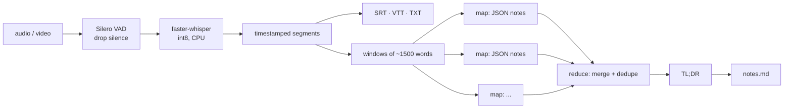

# meeting-notes

**Drop in a meeting recording, get structured notes back: TL;DR, key points, decisions, action items with owners, and open questions, each linked to the timestamp it came from.** Everything runs on your laptop. No uploads, no subscriptions, no meeting bot.

  

<!-- author-banner -->
> **Project 03 of 20** in my AI build series, designed and built by **[Abbishekk DGS](https://abbishekkdgs.tech)**. [See all projects →](https://github.com/Abbishekk-DGS)

## Example

Input: a 17-second recording of a product sync. Real output from `qwen2.5:3b` (`outputs/sync.notes.md`):

```markdown
## TL;DR
Product launch moved to March 15th. Priya will update the pricing page by Friday and
Arjun needs to fix the login bug before the demo.

## Key points
- Product launch moved to March 15th `00:00`

## Action items
| Task                | Owner | Due    | At      |
|---------------------|-------|--------|---------|
| Update pricing page | Priya | Friday | `00:06` |
| Fix login bug       | Arjun | -      | `00:12` |

## Open questions
- Do we still need the beta wait list? `00:12`
```

You also get `sync.srt` and `sync.vtt` subtitles, a timestamped `sync.txt` transcript, and `sync.json` for re-summarizing later without transcribing again.

## How it works



- **faster-whisper** (CTranslate2) runs Whisper up to 4× faster than the reference implementation, with int8 quantization on CPU.
- **VAD filtering** and `condition_on_previous_text=False` prevent Whisper's two classic failures: hallucinated text in silence and repetition loops on long audio.
- **Map-reduce summarization** means a 3-hour lecture works on a 3B model. Each window is summarized on its own, then merged in groups of four until one set of notes remains.
- **Schema-constrained JSON**: the notes schema goes to Ollama's `format` field, so the model's output is always valid JSON. No regex parsing of free text.
- A deterministic pass removes decisions that only restate an action item, a common small-model habit.
- Every item keeps its **timestamp**, so you can jump back to the recording and check it.

## Quickstart

```bash
ollama pull qwen2.5:3b               # https://ollama.com

git clone https://github.com/Abbishekk-DGS/meeting-notes && cd meeting-notes
uv sync

uv run meeting-notes meeting.m4a
uv run meeting-notes lecture.mp4 --whisper medium --language ta     # Tamil, larger model
uv run meeting-notes --from-transcript outputs/meeting.json --model llama3.1:8b
```

Any format ffmpeg can decode works (m4a, mp3, wav, mp4, mov, webm). ffmpeg is bundled through PyAV, so you don't need a separate install.

| `--whisper` | Speed (CPU) | Accuracy | RAM |
|---|---|---|---|
| base | fastest | good for clear audio | ~0.5 GB |
| small *(default)* | fast | strong | ~1 GB |
| medium | slower | very strong, better accents | ~2.5 GB |
| large-v3 | slowest | best, 99 languages | ~4.5 GB |

## Development

```bash
uv sync --extra dev
uv run pytest -q      # offline: the LLM is faked, no model downloads
```

## About the author

Built by **Abbishekk DGS**. More of my work at **[abbishekkdgs.tech](https://abbishekkdgs.tech)** and on **[GitHub](https://github.com/Abbishekk-DGS)**.

## License

MIT © Abbishekk DGS
